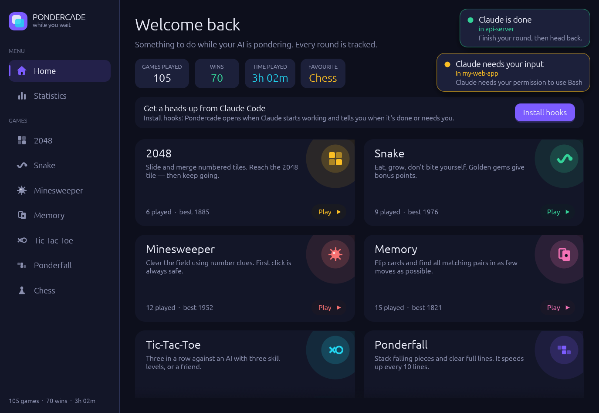
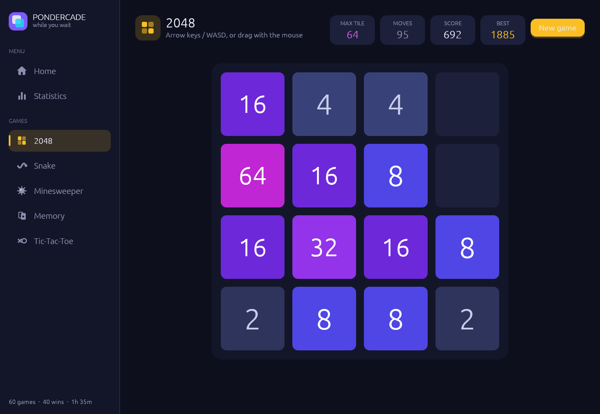
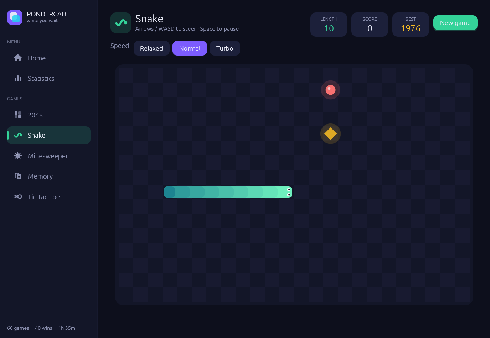
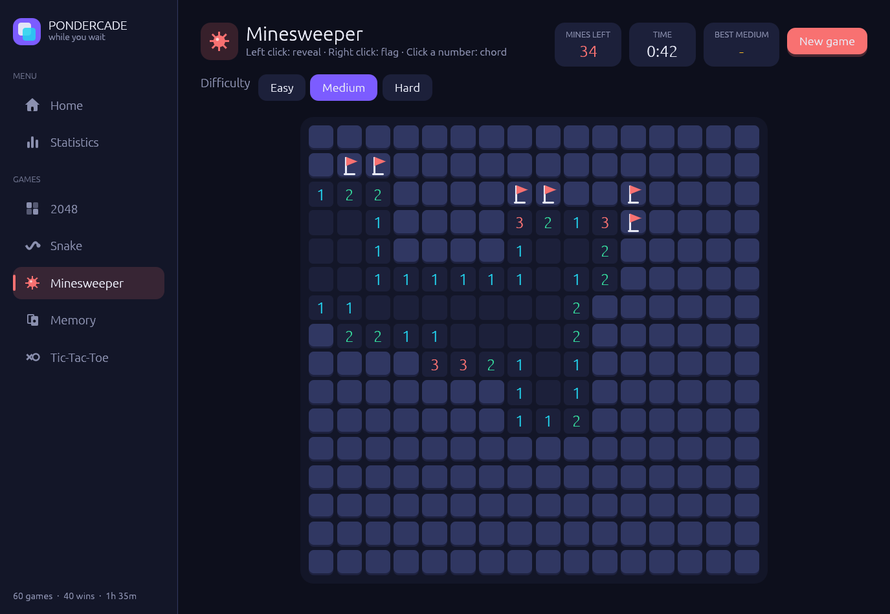
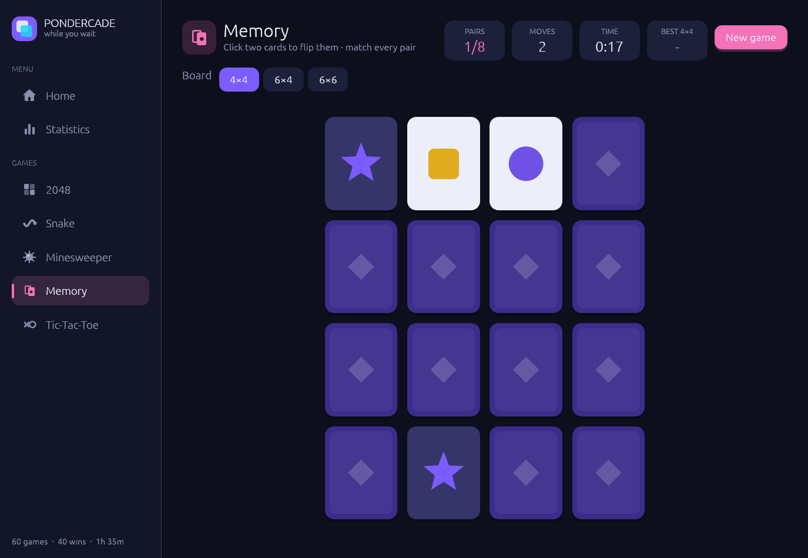
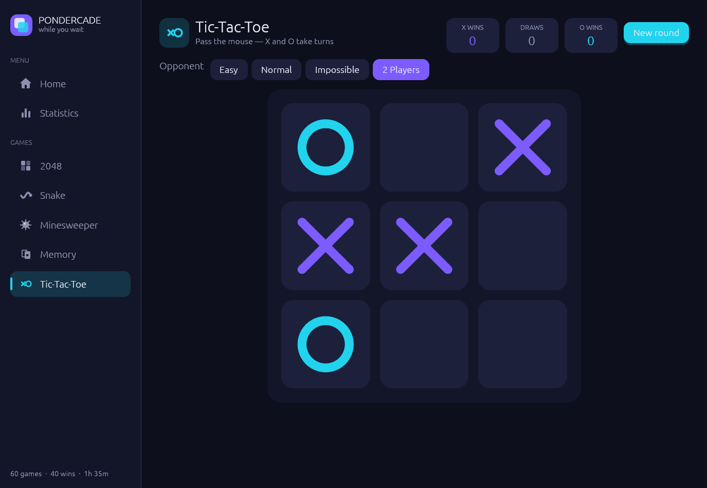
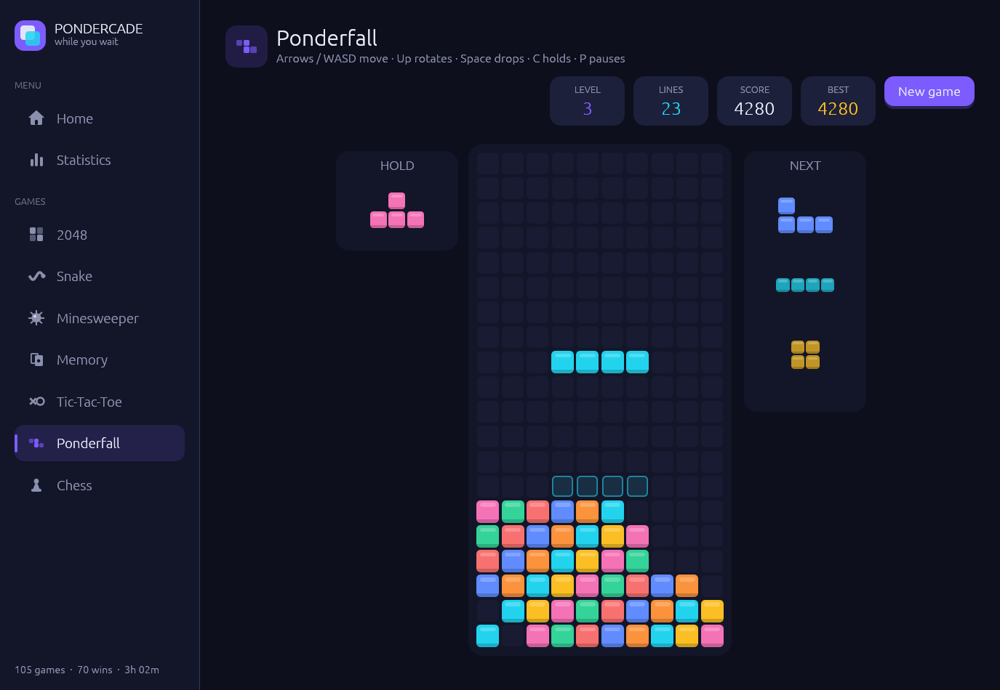
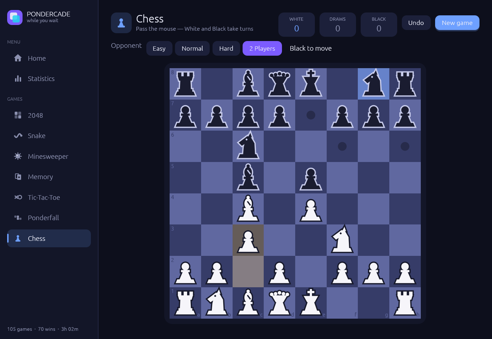
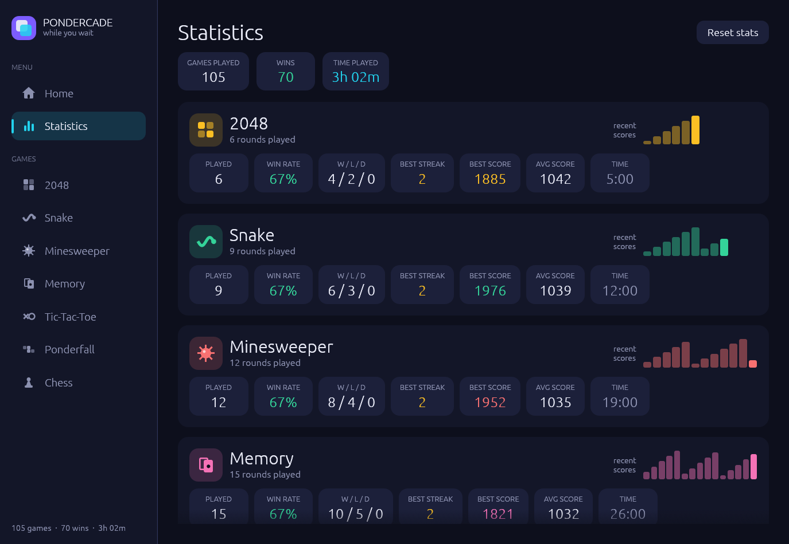

# 🕹️ Pondercade

> **Mini games for while your AI is pondering.**



## The problem

It's 2026. You no longer write code. You *describe* code, lovingly, in paragraphs, to an AI agent.
Then you press Enter, and the agent says:

```
✻ Pondering…
```

And you wait.

It reads 41 files. It runs the tests. It thinks about the tests. It *ponders* the tests.
It says `Noodling…`. Then `Percolating…`. Then, a bold new verb you have never seen before.
You can't touch the code — it's busy. You can't start something else — you'll lose the thread.
You can't stare at the spinner — the spinner can sense fear.

Old developers had *"my code's compiling"* as an excuse for sword fights in the hallway.
You have an agent that's *"just going to quickly check one more thing."*
You need a sword fight. Pondercade is that sword fight.

## The solution

Pondercade is a tiny desktop arcade with seven games built for the exact length of an agent's
"just a sec". Each one is easy to pick up and easy to drop again when the agent comes back with
*"I've made the following changes:"*

| | Game | Ideal for an agent that is… |
|---|---|---|
| 🔢 | **2048** | refactoring a 600-line file it promised was "a small change" |
| 🐍 | **Snake** | running the full test suite "just to be safe" |
| 💣 | **Minesweeper** | resolving merge conflicts (thematically appropriate) |
| 🃏 | **Memory** | re-reading files it already read 30 seconds ago |
| ❌ | **Tic-Tac-Toe** | asking for permission to run `ls` (you'll lose to *Impossible* mode faster) |
| 🧱 | **Ponderfall** | stacking up tool calls faster than it can clear them |
| ♟️ | **Chess** | thinking several moves ahead (so can you; *Hard* mode thinks for 1.5 seconds) |

### Features nobody asked for but everyone needed

- **Stats for everything.** Rounds, wins, streaks, best scores, best times and total play time —
  so you can quantify exactly how much of your career is now spent waiting. (Hide this page from your manager.)
- **Pretty.** Dark mode, smooth animations, no ads, no accounts, no "Sign in to sync your progress."
- **Tiny.** About 5 MB, one file, starts instantly. Smaller than the log your agent just printed.
- **Offline.** Works even when the AI is down. *Especially* when the AI is down.
- **Instantly hideable.** It's just a window. Alt-Tab is your panic button.
- **Knows when your agent is done.** Optional Claude Code hooks pop up a toast when Claude finishes
  or needs you. See [Claude Code integration](#claude-code-integration).

| | | |
|---|---|---|
|  |  |  |
|  |  |  |
|  |  | |

### Officially not affiliated

Pondercade is a fan-made joke, not affiliated with or endorsed by Anthropic, OpenAI, or any agent
that is currently pondering. No tokens were harmed in the making of this arcade. (Several were spent.)

---

## Download

Grab the latest build for your OS from the **[Releases page](https://github.com/JBrownSchue/pondercade/releases/latest)**:

| OS | File | How to run |
|----|------|------------|
| Windows (x64) | `pondercade-windows-x64.zip` | Unzip and run `pondercade.exe`. If SmartScreen warns about an unknown publisher, click **More info → Run anyway**. |
| macOS (Apple Silicon & Intel) | `pondercade-macos-universal.zip` | Unzip and move `Pondercade.app` to *Applications*. The app isn't notarized, so the first time **right-click → Open** (on macOS 15+: try to open it, then *System Settings → Privacy & Security → Open Anyway*). |
| Linux (x64) | `pondercade-linux-x64.tar.gz` | `tar xzf pondercade-linux-x64.tar.gz && ./pondercade`. Needs OpenGL and X11 or Wayland (any normal desktop). |

## Controls

| Game | Controls |
|------|----------|
| 2048 | Arrow keys / WASD, or drag with the mouse |
| Snake | Arrow keys / WASD to steer, Space to start/pause; three speeds |
| Minesweeper | Left click reveals, right click flags, clicking a number reveals its neighbours; Easy / Medium / Hard |
| Memory | Click two cards; 4×4, 6×4 or 6×6 boards |
| Tic-Tac-Toe | Click a cell; Easy / Normal / Impossible AI, or 2 players |
| Ponderfall | ←/→ (A/D) move, ↑ / W / X rotate, Z / Q rotate back, ↓ (S) soft drop, Space hard drop, C hold, P / Esc pause |
| Chess | Click a piece, then a highlighted square; Easy / Normal / Hard AI (play as White or Black), or 2 players; Undo takes back your last move |

## Claude Code integration

Let Pondercade tell you when your agent is finished, so you can stop staring at the spinner *and* stop
checking on it every 20 seconds.

1. Open Pondercade and click **Install hooks** on the Home page.
2. Start a new Claude Code session. That's it.

From then on:

- **Claude starts working** (you send a prompt) → Pondercade opens if it isn't already running.
  Turn this off with the **Auto-open** button if you'd rather open it yourself.
- **Claude is done** → a green *"Claude is done"* toast, and the taskbar/dock icon flashes if
  Pondercade is in the background. Finish your round, then head back.
- **Claude needs you** (a permission prompt, a question, or it's been waiting a while) → an amber
  *"Claude needs your input"* toast with Claude's message. It stays until you click it.

Toasts show which project they're about, so several Claude sessions at once work fine.

**How it works:** the button adds three hooks (`UserPromptSubmit`, `Stop`, `Notification`) to
`~/.claude/settings.json`. Your other settings and hooks are kept, and a backup is saved next to the
file as `settings.json.pondercade-backup` the first time. Each hook runs `pondercade hook`, which
reads the event Claude Code sends, appends one line to `claude/events.jsonl` in the stats folder
below and exits right away. The hooks run asynchronously and print nothing, so they never slow
Claude down or change what it sees. **Remove hooks** takes them out again.

The hooks point at wherever Pondercade is when you click Install. If you move the app, click
**Reinstall hooks** (the Home page tells you when it's needed). On macOS, move `Pondercade.app` to
*Applications* first. From a terminal you can also run `pondercade install-hooks` /
`pondercade uninstall-hooks` (exit code 0 means success).

## Where are my stats?

Stats are saved automatically when you close the app:

- **Windows:** `%APPDATA%\Pondercade\data\app.ron`
- **macOS:** `~/Library/Application Support/Pondercade/app.ron`
- **Linux:** `~/.local/share/pondercade/app.ron`

You can reset them from the **Statistics** page.

## Building from source

Requires [Rust](https://rustup.rs) 1.95 or newer.

```sh
git clone https://github.com/JBrownSchue/pondercade
cd pondercade
cargo run --release      # build and start
cargo test               # game logic tests
```

On Linux you may need the usual windowing dev packages first, e.g. on Debian/Ubuntu:

```sh
sudo apt install libxkbcommon-dev libwayland-dev libxcb-render0-dev libxcb-shape0-dev libxcb-xfixes0-dev libgl1-mesa-dev
```

The release profile is tuned for size (`opt-level = "z"`, LTO, `panic = "abort"`, stripped).
There are no image or font assets beyond egui's default font: every icon is drawn in code.

### Making a release

Releases are built by GitHub Actions (`.github/workflows/release.yml`) for Windows, macOS (universal) and Linux.
Push a version tag and the workflow builds all three and attaches them to a GitHub Release:

```sh
git tag v0.2.0
git push origin v0.2.0
```

### Development helpers (debug builds only)

- `PONDER_SHOTS=<dir>` cycles through every screen, saves PNG screenshots to `<dir>` and exits
  (uses its own storage, so your real stats are untouched).
- `PONDER_SIZE=WxH` sets the initial window size, e.g. `PONDER_SIZE=700x480` to test small layouts.

## Tech

[Rust](https://www.rust-lang.org) + [egui/eframe](https://github.com/emilk/egui) (OpenGL via glow).
No game engine, no web view, no Electron — your RAM is busy enough hosting the agent.

## License

[MIT](LICENSE)
